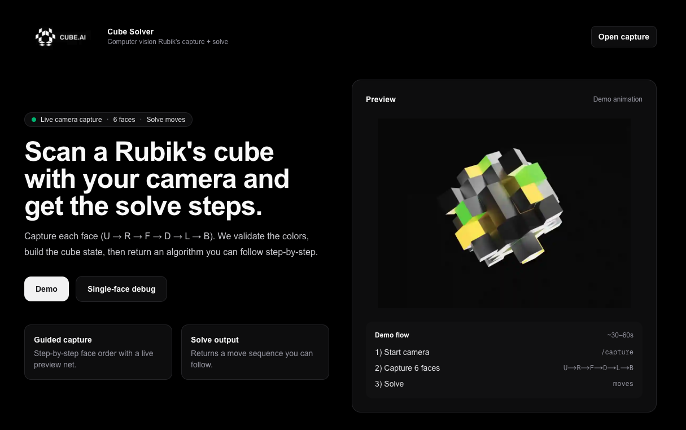
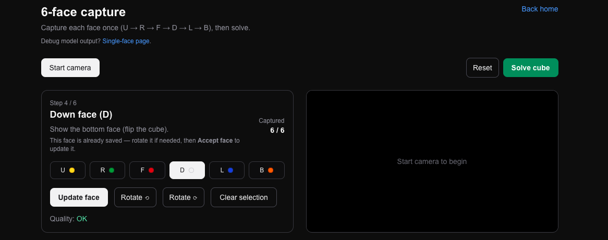
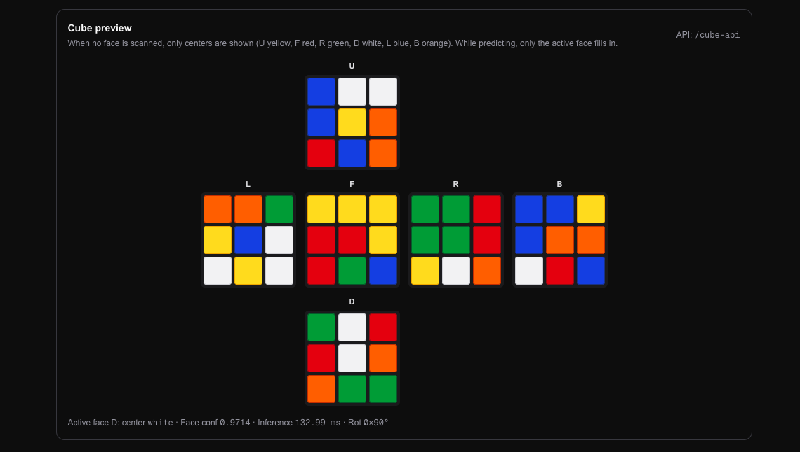
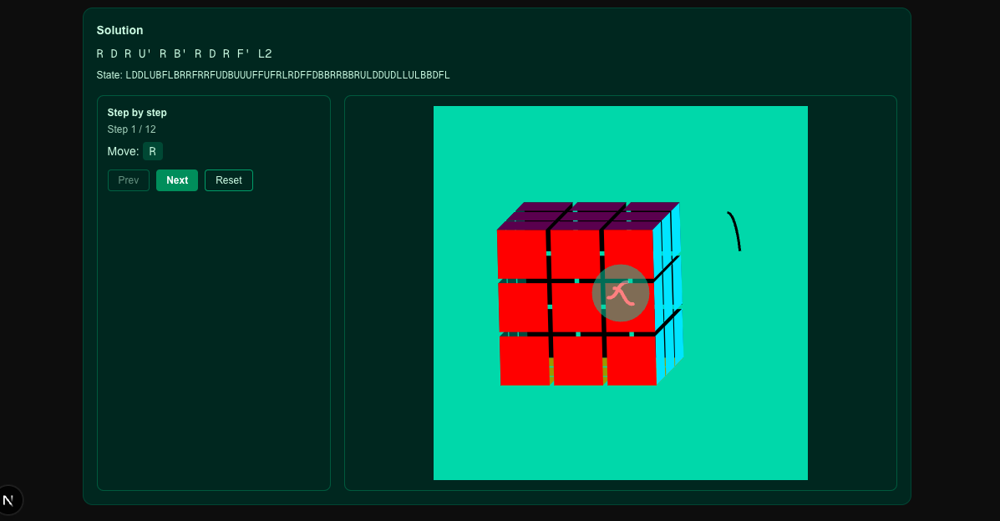

# Computer Vision Cube Solver — Project Report

## 1. Introduction

This report documents the iterative engineering process behind a computer
vision pipeline that captures a Rubik's cube from a live camera feed and
reconstructs its full 54-sticker state for downstream solving. The work
focuses on two complementary problems:

1. **Detecting the cube face** in arbitrary photos and isolating its 3x3 grid
   in a normalized perspective.
2. **Classifying the color** of each of the 9 stickers per face robustly,
   under varying lighting, exposure, white balance, and camera quality.

Multiple modeling approaches were attempted before converging to a final
pipeline that achieves high accuracy and is robust to real-world conditions.
Each stage below describes the motivation, the methodology, the failure
modes that emerged, and the quantitative or qualitative evidence that
informed the next iteration.

---

## 2. System Overview

The final pipeline follows a two-stage design:

```
camera frame
    -> [Stage 1] Cube face detector (YOLO-OBB)
    -> oriented bounding quad of the face
    -> perspective warp + 3x3 grid sampling
    -> 9 sticker crops per face
    -> [Stage 2] Sticker color classifier
    -> face state (3x3 of canonical colors)
```

Stage 1 produces a tight, oriented region of interest. Stage 2 ingests the
9 normalized sticker crops and returns one of six canonical colors per
sticker. The final 3x3 face is then composed with the rest of the cube and
passed to a solver.

---

## 3. Stage 1 — Cube Face Detection (Oriented Object Detection)

### 3.1 Motivation

Detecting only the **front face** of the cube — rather than the full
cuboid silhouette — gives the next stage a clean, planar surface to
sample stickers from. To support natural hand-held framing where the cube
is rarely perfectly axis-aligned, an **oriented bounding box** model was
chosen over a standard axis-aligned detector. The oriented quadrilateral
allows a downstream perspective warp into a square canvas, after which the
3x3 grid is trivially extracted.

### 3.2 Approach

A pretrained YOLO oriented-object-detection (OBB) backbone was fine-tuned
on a curated dataset of cube photos. Each image was annotated with a
quadrilateral around the visible face. Standard data augmentation was
enabled (horizontal flip, scale jitter, color jitter, mosaic, random
erasing) and training was carried out on a single accelerator device for
50 epochs at 640 x 640 resolution.

### 3.3 Qualitative Results

The training and validation batches show the model learning to localize the
face under varied perspectives, partial occlusions, and lighting.

| Stage | Visualization |
|---|---|
| Training batch (early) |  |
| Training batch (late) |  |
| Validation labels |  |
| Validation predictions |  |
| Per-class label distribution |  |

### 3.4 Quantitative Results

The model converges quickly and reaches high precision and recall. The
training curves and operating-point analyses are summarized below.

| Metric | Plot |
|---|---|
| Overall training/validation curves |  |
| Precision–Recall curve (oriented box) |  |
| F1 vs. confidence |  |
| Precision vs. confidence |  |
| Recall vs. confidence |  |
| Confusion matrix |  |
| Confusion matrix (normalized) |  |

**Headline numbers (final epoch):**

- Precision ~ 0.97
- Recall ~ 0.94
- mAP@0.5 ~ 0.98
- mAP@0.5:0.95 ~ 0.96

The detector is therefore a reliable upstream component: it produces a
clean oriented quadrilateral that can be warped into a normalized face
crop for the color stage.

---

## 4. Stage 2 — Sticker Color Recognition (Iterations)

The color stage proved to be substantially harder than the detection
stage. Three distinct approaches were attempted before the pipeline
reached production-quality robustness.

### 4.1 First attempt — Whole-face image classifier

#### Approach

A classification model was trained on whole sticker / face photographs
collected in unconstrained conditions. The model was fed *uncropped*
sticker regions and asked to output the dominant color directly. The
training set contained images of plain colored objects in addition to
stickers, with substantial variability in framing, exposure, and
backgrounds.

#### Why it underperformed

Without a precise, repeatable crop around each sticker:

- The model often latched onto background pixels (skin, table, holder).
- Mixed exposures across frames pushed similar sticker colors (e.g. red /
  orange, green / blue under cool white balance) into overlapping
  regions of feature space.
- The model had no explicit signal about *where* in the image the sticker
  was; it had to learn detection and classification simultaneously, which
  is data-hungry given the small variety of training photos.

The resulting classifier achieved acceptable accuracy on photos similar
to the training distribution but degraded sharply on new lighting and
angles, especially confusing **red <-> orange** and **white <-> yellow**
under warm light.

**Conclusion:** the lack of a deterministic, per-sticker crop made this
approach unreliable in the wild.

---

### 4.2 Second attempt — Classical HSV thresholding on detected stickers

#### Approach

After the OBB detector was working, the next iteration replaced the
neural classifier with a deterministic HSV-based color reader. For each
sticker crop, a robust mean color was computed (median in the central
region of the sticker), converted to HSV, and matched to canonical
reference colors using hue distance with saturation and value gates for
white.

#### Why it underperformed

HSV-based readers are simple and fast, but they are highly sensitive to
illumination and white balance. Two systematic failures emerged:

- **Red <-> orange** confusion. Both colors live near the same hue band,
  and warm indoor lighting pushes red toward orange and vice versa. A
  fixed hue threshold could not separate them reliably across phones,
  lights, and exposures.
- **White <-> yellow** confusion under warm light, where white stickers
  pick up a yellow cast and saturated yellow stickers desaturate.

Calibration could mitigate one scenario at the cost of another. This
suggested the need for a learned model that could take into account
texture, gradients, and the specific physical look of cube stickers,
rather than relying on a single hue value.

**Conclusion:** classical color thresholding cannot cover the variability
of real-world capture conditions.

---

### 4.3 Final approach — Per-sticker classifier on a synthetic dataset

#### Approach

The final approach combines two ideas:

1. **Use the detector to crop precisely**: each of the 9 stickers is
   sampled from the warped face into a small, square image patch. The
   classifier therefore always sees a centered sticker region with no
   background.

2. **Train on a controlled synthetic dataset**: a programmatically
   generated dataset was created from canonical sticker colors, with
   heavy photometric augmentation that mimics realistic capture
   variability — random exposure, brightness, contrast, color jitter,
   white-balance shifts, blur, JPEG compression artifacts, and
   light/shadow variation. Each color class therefore contains a wide
   range of plausible appearances of a single canonical color.

This produces a dataset that is large, balanced across classes, and
specifically engineered to teach the model to **be invariant to the
exact lighting conditions** while remaining sensitive to the underlying
color identity. The classifier was trained at 224 x 224 input resolution
with standard augmentation pipelines.

#### Sample of the (one image per color)

| Class | Example seed |
|---|---|
| White |  |
| Yellow |  |
| Red |  |
| Orange |  |
| Green |  |
| Blue |  |

Each base color is then expanded into hundreds of augmented variants per
class to build the actual training and validation sets.

#### Quantitative results

The classifier converges in just a few epochs with very low loss on both
splits and near-perfect top-1 / top-5 accuracy on the validation set.
The training summary, validation predictions, and confusion matrices are
shown below.

| Plot | Visualization |
|---|---|
| Training summary (loss / accuracy) |  |
| Confusion matrix |  |
| Confusion matrix (normalized) |  |
| Training batch |  |
| Validation labels vs. predictions |  |

**Headline numbers:**

- Top-1 accuracy ~ 1.00 on the synthetic validation split.
- Top-5 accuracy ~ 1.00.
- Train loss decreases smoothly and validation loss stays low, showing
  no overfitting on the augmentation distribution.

Most importantly, qualitative testing on real captures confirms what the
synthetic-dataset strategy was designed to deliver: the **red <-> orange**
confusion that plagued the HSV approach is eliminated, and the model is
robust to a wide range of natural lighting conditions.

---

## 5. End-to-End Pipeline (Final)

The production pipeline now combines the two best models:

1. **Face localization.** The oriented detector returns a tight quad
   around the front face of the cube in the camera frame.
2. **Geometric normalization.** A perspective warp places the face on a
   square canvas, so that sticker positions are deterministic.
3. **Sticker sampling.** The 9 stickers are extracted as small square
   crops from the canvas.
4. **Color classification.** Each sticker crop is classified with the
   synthetic-trained classifier, producing one of six canonical colors.
5. **State assembly.** The 3x3 face grid is composed with the other
   five faces (collected via a guided capture flow) into a 54-sticker
   state, which is then handed to the solver.

This separation of concerns — *detect the face*, *normalize geometry*,
*classify colors* — was the key architectural insight that finally made
the system robust.

---

## 6. Frontend (user interface)

The web client wraps the vision and solving stack in a guided flow: a
landing page, a six-face capture workflow with live camera feedback, a
two-dimensional cube preview that reflects model output, and a solution
panel with the move string plus a step-by-step animated guide.

### 6.1 Home page

The entry screen introduces the product and routes the user to the live
capture demo.



### 6.2 Guided capture (camera and face steps)

The capture view walks through faces in a fixed order, shows per-face
hints, exposes camera controls, and surfaces a quality indicator so the
user only accepts frames when the model is confident.



### 6.3 Cube preview (two-dimensional net)

A net-style preview summarizes the current scan: default center colors
before capture, then filled stickers for the active face (and saved
faces) as predictions arrive. Metadata such as center color, face
confidence, and inference time supports debugging.



### 6.4 Solution moves and animated guidance

After all faces are captured, the solver returns an algorithm string and
an optional facelet state. The UI lists the full sequence and offers a
step-by-step panel: each move highlights the next token and plays a
matching animation so the user can follow the solution on a physical
cube.



---

## 7. Lessons Learned

- **Crop precision dominates color accuracy.** Once the classifier
  always saw a centered sticker patch, the color problem became much
  easier — and many ambiguities collapsed.
- **Real-world capture is not a "color sensor".** Hue alone is
  insufficient because of white balance, exposure, and gamut differences
  between devices. A learned model that has been trained against these
  perturbations is dramatically more robust than fixed thresholds.
- **Synthetic data plus aggressive photometric augmentation is a
  pragmatic substitute for a large field-collected dataset.** It is
  cheap, balanced, controllable, and — when the augmentation distribution
  matches the deployment distribution — generalizes well.
- **Oriented detection is a natural fit for planar surfaces in
  hand-held captures.** It removes the need for a separate rectification
  step driven by heuristics.

---

## 8. Future Work

- **Adaptive color calibration.** Use the four corner stickers (or
  external markers) for a per-frame illuminant estimate that further
  reduces residual variance.
- **Real-world dataset expansion.** Continuously collect mis-classified
  real-world stickers, label them, and fold them into the training mix
  to cover edge cases the synthetic distribution misses.
- **Joint detection + classification model.** Investigate a single
  multi-task network that detects the face and emits the 3x3 color grid
  in one pass, to reduce latency in mobile deployments.
- **Temporal smoothing.** Aggregate predictions across multiple frames
  while the user holds the cube, to suppress occasional per-frame
  errors.
